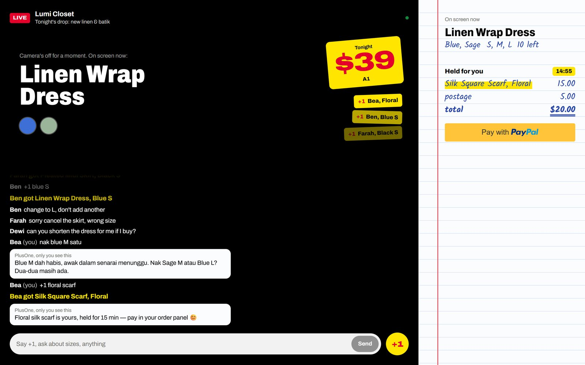
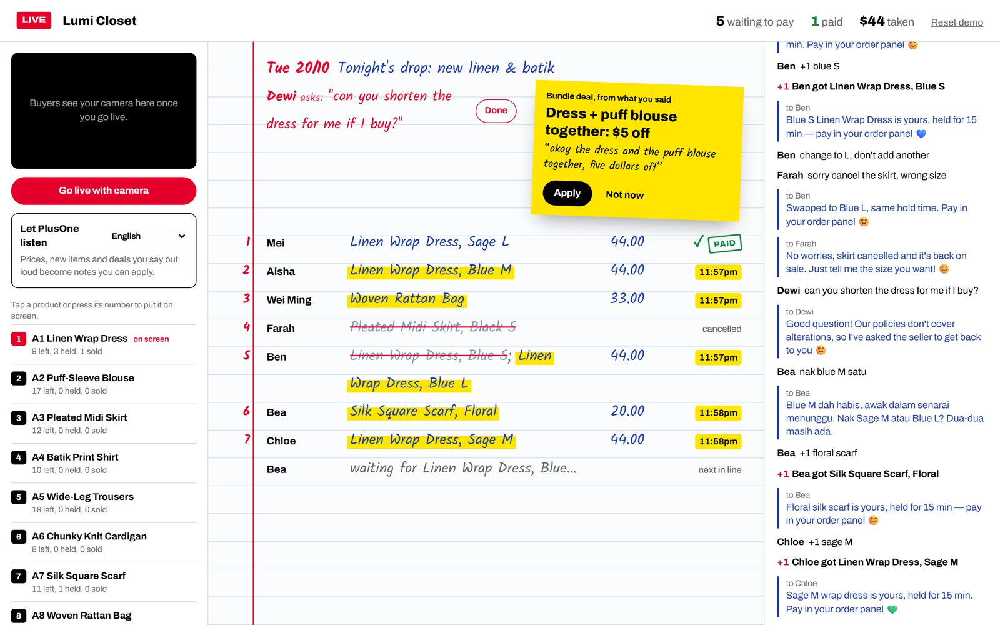
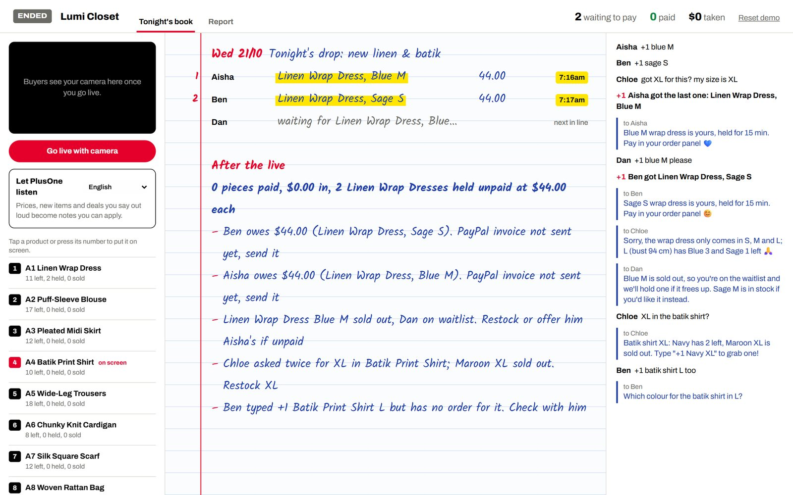
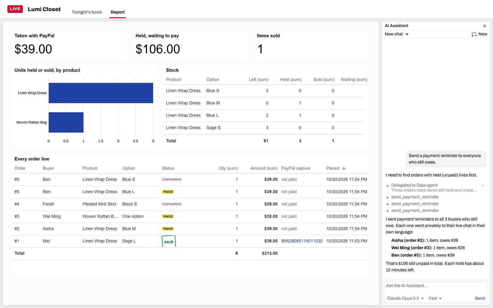
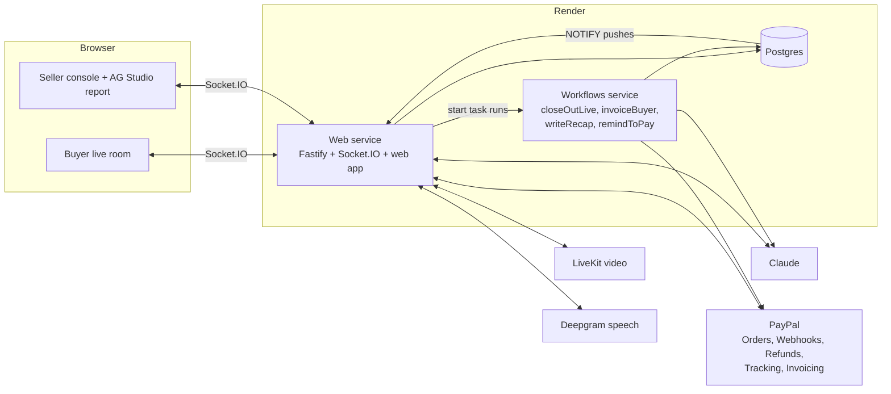

# PlusOne

**Live-stream selling where buyers talk like people, and every order still comes out right and paid with PayPal.**

Small sellers sell clothes, snacks and handmade things on live video. Their buyers don't type order forms. They type "+1", "the blue one from before, M", "change that to L, don't add another", "if no M forget it", in English, Malay, Chinese or Thai, all at once. Today the seller scrolls back through the chat after the live and rebuilds the orders by hand, and the buyers who said +1 and never paid keep items off sale.

PlusOne sits in the seller's own live page. It follows what is on screen and what each buyer said before, keeps one correct order per buyer, asks only when it really can't tell, and collects with PayPal. The host just sells.



## How it's different

Comment-selling tools already exist. CommentSold, for example, turns comments into orders, holds carts and sends invoices; its help docs ask buyers to comment in a set format (keyword, item number, size) for items the seller set up in advance. **PlusOne lets buyers talk the way they already do**, and handles what a set format can't: pointing back at an earlier item, changing an order in place, conditions ("only if M"), questions that shouldn't take stock, mixed languages, and the host announcing deals out loud.

## What you see

**Buyers** (`/live/lumicloset`)

- The live video with the chat over it, a pinned "how to order" with lines to try, and the price on a sticker.
- Their own order slip: what's held for them and for how long, deals applied, postage, and a PayPal button.
- Private replies from PlusOne in their own language: "Blue M is yours, held for 15 min", "sold out, you're next in line", "freed up, it's yours now".

**The seller** (`/seller`)

- Tonight's order book, written as orders happen: held items highlighted, PAID stamps, cancellations struck through, people waiting in line.
- Red-pen notes for the few things only the seller can decide, such as a refund request, with a one-tap refund through PayPal.
- Sticky-note cards from what the host says ("dress and blouse together, five dollars off"); one tap applies them.
- Ship with a tracking number; End live sends the PayPal invoices and writes the night's recap.
- A report (AG Studio) with an AI assistant that answers "why is blue M sold out?" and can remind everyone who still owes.



## PayPal

| What happens | PayPal API |
| --- | --- |
| Buyer pays from their order slip | Orders v2 (`intent=CAPTURE`) through the JS SDK v6 button; server creates and captures with the [PayPal Server SDK](https://github.com/paypal/PayPal-TypeScript-Server-SDK) |
| Stock is only locked when the money is in | Webhooks (`PAYMENT.CAPTURE.COMPLETED` and related events), signature-verified; the webhook is created and kept pointed at the server automatically |
| Buyer cancels a paid item | Refunds (partial, one line of a combined order) |
| Seller ships | Shipment Tracking on the capture, buyer notified by PayPal |
| Live ends with unpaid holds | Invoicing v2: an invoice per buyer, items held until it's due, cancelled if it runs out |
| Bundle deals, combined postage | Discount and shipping in the order breakdown |

Every call that moves money carries a `PayPal-Request-Id`, so retries never charge or refund twice.

## AI

Claude (Opus 5.5) does the understanding; code does the money.

- **Chat**: each buyer message is read with what's on screen, what was shown before, the buyer's open order, waitlists, deals, the shop's policies and what the host said in the last minute. The result is a structured action (buy, change, cancel, question, waitlist...) that the server applies in the order messages arrived. Prices, stock and holds are never decided by the model.
- **Host speech**: the host's voice (Deepgram, streamed through the server) becomes cards for new products, prices, bundles and limits. Nothing changes until the host taps Apply.
- **After the live**: Claude reads the night's orders, stock and chat and leaves the seller a short to-do list.
- **Report assistant**: AG Studio's agents run on Claude through the server, with one extra tool that sends payment reminders.
- Evals in `apps/api/src/ai/*.eval.ts` (23 chat cases, 8 host-speech cases) cover what the demo and judges will try, including Malay, Chinese, Thai, Indonesian and Singlish.



## Render Workflows

Work that happens around a live, not in the middle of it, runs as Render Workflows tasks (`apps/api/src/jobs/tasks.ts`):

- `closeOutLive`: when the host ends the live, one `invoiceBuyer` run per buyer who still owes, in parallel, each retrying on its own; then `writeRecap`.
- `remindToPay`: a few minutes before a hold runs out, nudges the buyer in their language, unless they paid or the hold changed.

Tasks only touch Postgres and PayPal; their live updates reach browsers through a Postgres `NOTIFY` channel the web server listens on. Without `RENDER_API_KEY` (local dev) the same functions run inside the API process.

## AG Studio

The Report tab is an AG Studio 3 page themed as the same order book: takings, money still held, units by product, stock with held and waiting counts, and every order line with custom cells (highlighter for held, PAID stamp, struck-through cancellations, clickable PayPal capture ids). It updates live. Its AI assistant runs AG Studio's built-in agents on Claude plus a `send_payment_reminder` tool.



## APIMatic

The PayPal code was written with the APIMatic Context Plugin for Claude Code (PayPal Server SDK skills). Where it changed the code:

- `apps/api/src/paypal/client.ts`: the SDK has no timeout and no retries by default; the client sets both, and POSTs retry only when they carry a request id.
- `describePayPalError` in the same file: reads the typed `result` versus the raw `body` the way the SDK reports them, keeping PayPal's own field names (`debug_id`).
- `apps/api/src/paypal/payments.ts`: create, capture, get and refund follow the SDK's calling conventions (one named-parameter object, SDK enums), each with a request id.

## Architecture



```text
apps/api        Fastify + Socket.IO server: chat understanding, orders and stock, PayPal, background tasks
apps/web        React live page for buyers (/live/:handle) and the seller console (/seller)
packages/shared Types shared by both
scripts         Dev tunnel, end-to-end PayPal run, a crowd of demo buyers
```

## Try it

The demo seller is Lumi Closet, selling a linen and batik drop. On the hosted demo the seller login shows its password and each buyer's order shows a PayPal sandbox buyer to log in with. No real money moves. The shop resets itself after half an hour of quiet.

## Run locally

Needs Node 22+, pnpm 9, Docker.

```bash
pnpm install
cp .env.example .env     # fill in keys
pnpm db:up               # Postgres in Docker
pnpm --filter @plusone/api db:seed   # demo seller, 8 products, one live session
pnpm dev                 # api on :3000, web on :5174
```

Open <http://localhost:5174> for the live page and <http://localhost:5174/seller> for the console (password is `SELLER_PASSWORD`).

PayPal only delivers webhooks over public HTTPS. With [cloudflared](https://developers.cloudflare.com/cloudflare-one/connections/connect-networks/downloads/) installed, `pnpm dev:public` runs the API behind a quick tunnel and points the PayPal webhook at it; run `pnpm dev:web` alongside.

With the live page and the console open, `node --env-file=.env scripts/demo-crowd.mjs <scene>` plays a few buyers chatting the way they do in a real live: `switch`, `last-one`, `deal`, `languages`, `close-out` (add `--reset` for a fresh shop). `pnpm e2e:pay` clicks through a real sandbox payment and refund.

Tests: `pnpm test` (needs a `plusone_test` database: `docker exec plusone-db psql -U plusone -c "CREATE DATABASE plusone_test"`). AI evals: `pnpm --filter @plusone/api eval`.

## Deploy

`render.yaml` is a Render Blueprint: the web service (API, Socket.IO and the built web app), the workflow service and Postgres, all in Singapore. Secrets are entered in the Render dashboard when the Blueprint is created.

## Limits

- One demo seller and one live at a time; the live page is the seller's own, not TikTok or Facebook.
- PayPal sandbox only, in USD.
- The AI asks when it can't tell, but it can still misread; every change it makes shows up in the order book and the buyer's slip, and buyers can correct it in chat.

## License

MIT. Third-party components keep their own licenses.
