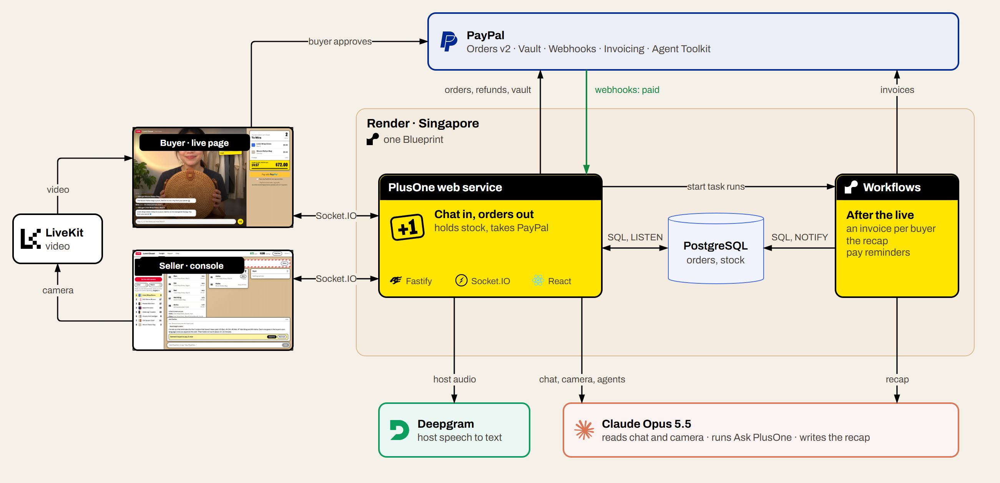

# PlusOne

**Live-stream selling where buyers talk like people, and every order still comes out right and paid with PayPal.**

Small sellers sell clothes, snacks and handmade things on live video. Their buyers don't type order forms. They type "+1", "the blue one from before, M", "change that to L, don't add another", "if no M forget it", in English, Malay, Chinese or Thai, all at once. Today the seller scrolls back through the chat after the live and rebuilds the orders by hand, and the buyers who said +1 and never paid keep items off sale.

PlusOne sits in the seller's own live page. It follows what is on screen and what each buyer said before, keeps one correct order per buyer, asks only when it really can't tell, and collects with PayPal. The host just sells.


## How it's different

Comment-selling tools are common: CommentSold and SoldLive in the US, SHOPLINE in Hong Kong and Taiwan, EasyStore and BigSeller in Southeast Asia. They turn comments into orders, hold carts, run waitlists and send invoices, and they all ask buyers to type a code: `A1+1`, `CF A01`, `sold 12`. The nearest anyone comes to reading free text is SHOPLINE labelling comments as purchase, question, positive or negative (it doesn't create orders) and SoldLive confirming the variant by text message after the comment.

**Others make buyers type a code. PlusOne reads the live chat the way a person does, while the live is happening:**

- "the blue one from before, M" is matched to the product the host showed earlier;
- "change to L, don't add another" edits the order in place;
- "if no M forget it" becomes a conditional order that never takes a different colour;
- "still got pink S?" gets an answer without taking stock;
- English, Malay, Chinese, Thai and Indonesian, mixed in one sentence, answered in the buyer's own language;
- and it asks one short question only when it really can't tell.

Holds, waitlists, per-person limits, reminders and invoices work the way sellers already expect from comment-selling tools; PlusOne runs them through PayPal.

## What you see

**Buyers** (`/live/lumicloset`)

- The live video with the chat over it, a pinned "how to order" with lines to try, and the price on a shelf label.
- Their order as the shipping label it will become: what's held for them with a colour swatch per item, deals, postage, and a yellow hold bar that drains until they pay with PayPal. Paid orders get a barcode; shipped ones show the carrier and tracking number.
- Private replies from PlusOne in their own language: "Blue M is yours, held for 15 min", "sold out, you're next in line", "freed up, it's yours now".
- **Saved PayPal and auto-pay.** At the first checkout the buyer can save their PayPal with the shop (PayPal asks them to agree). After that, the next order is one tap with no PayPal window. Or they turn on auto-pay for this live, up to $50, $100 or $200: then saying "+1 the rattan bag" is the whole purchase. The label counts down 15 seconds after the order last changed, so "and the scarf too" joins the same payment; a question from PlusOne pauses the countdown until they answer.

**The seller** (`/seller`)

- Every order as a label on the packing table, sorted into three lanes: waiting to pay (with its hold draining and a Remind button), paid and ready to pack, sent. People waiting in line, and the latest +1s scrolling across the top.
- The few things only the seller can decide, on red packing tape across the top, such as a refund request with a one-tap refund through PayPal.
- Cards from what the host says ("dress and blouse together, five dollars off"); one tap applies them, and buyers holding the dress are offered the blouse.
- **Let PlusOne watch**: with the camera on, the host holds a product up and it goes on screen for buyers, so their "+1" means what they can see. No tapping mid-sale.
- Ship with a tracking number; End live sends the PayPal invoices and writes the night's recap.
- **Ask PlusOne**: type or say "Hey PlusOne, who still owes?" and it looks through tonight's orders and the shop's PayPal account (PayPal Agent Toolkit). Anything that moves money or messages buyers comes back as a card to approve: remind them in chat, send PayPal invoice reminders, refund a line, ship with a tracking number. It can also put a product on screen or make a pay QR code for an invoice.
- A report (AG Studio) with an AI assistant that answers "why is blue M sold out?" and can remind everyone who still owes.


## PayPal

| What happens | PayPal API |
| --- | --- |
| Buyer pays from their order slip | Orders v2 (`intent=CAPTURE`) through the JS SDK v6 button; server creates and captures with the [PayPal Server SDK](https://github.com/paypal/PayPal-TypeScript-Server-SDK) |
| Stock is only locked when the money is in | Webhooks (`PAYMENT.CAPTURE.COMPLETED` and related events), signature-verified; the webhook is created and kept pointed at the server automatically |
| Buyer cancels a paid item | Refunds (partial, one line of a combined order) |
| Seller ships | Shipment Tracking on the capture, buyer notified by PayPal |
| Live ends with unpaid holds | Invoicing v2: an invoice per buyer, items held until it's due, cancelled if it runs out |
| Bundle deals, combined postage | Discount and shipping in the order breakdown |
| Buyer saves PayPal at checkout | Orders v2 with `payment_source.paypal.attributes.vault` (`store_in_vault: ON_SUCCESS`, merchant usage); the vault id and customer id come back on capture |
| One-tap pay, auto-pay | Orders v2 with `payment_source.paypal.vault_id`, completed in one call, shipped to the address from the saving checkout |
| Buyer forgets their saved PayPal | Payment Method Tokens `DELETE /v3/vault/payment-tokens/{id}` |
| Ask PlusOne | [PayPal Agent Toolkit](https://github.com/paypal/agent-toolkit): orders, invoices (list, search, get, QR code, send reminder, cancel), refunds, shipment tracking, disputes |

Every call that moves money carries a `PayPal-Request-Id`, so retries never charge or refund twice.

## Agents that spend, with limits

Two agents in PlusOne move money, and each one has a limit someone chose.

- **The buyer's**: auto-pay. The buyer saves their PayPal, picks a limit for one live, and from then on what they say in chat is what they buy. Every change restarts a short countdown on their label, a question from PlusOne pauses it, the limit is checked again at the moment of payment, and a declined payment turns auto-pay off instead of retrying. Changed their mind? They say so in chat and the seller refunds that item through PayPal.
- **The seller's**: Ask PlusOne. It reads freely: tonight's orders, stock, waitlists, and the shop's PayPal invoices, refunds, tracking and disputes through PayPal's Agent Toolkit. It doesn't send anything by itself. Reminders, invoice reminders, cancellations, refunds and shipping come back as cards the seller approves, one by one or all at once.


## AI

Claude (Opus 5.5) does the understanding; code does the money.

- **Chat**: each buyer message is read with what's on screen, what was shown before, the buyer's open order, waitlists, deals, the shop's policies and what the host said in the last minute. The result is a structured action (buy, change, cancel, question, waitlist...) that the server applies in the order messages arrived. Prices, stock and holds are never decided by the model.
- **Host speech**: the host's voice (Deepgram, streamed through the server) becomes cards for new products, prices, bundles and limits. Nothing changes until the host taps Apply.
- **Host camera**: every two seconds or so the console sends a small frame from the host's camera; Claude names the catalog product being shown, or none. The product goes on screen only when two frames in a row agree. Frames aren't stored.
- **After the live**: Claude reads the night's orders, stock and chat and leaves the seller a short to-do list.
- **Ask PlusOne**: Claude with tool use over tonight's orders and the PayPal Agent Toolkit's tools; the host can also ask it out loud ("Hey PlusOne, ...") while selling.
- **Report assistant**: AG Studio's agents run on Claude through the server, with one extra tool that sends payment reminders.
- Evals in `apps/api/src/ai/*.eval.ts` (24 chat cases, 8 host-speech cases) cover what the demo and judges will try, including Malay, Chinese, Thai, Indonesian and Singlish.


## Render Workflows

Work that happens around a live, not in the middle of it, runs as Render Workflows tasks (`apps/api/src/jobs/tasks.ts`):

- `closeOutLive`: when the host ends the live, one `invoiceBuyer` run per buyer who still owes, in parallel, each retrying on its own; then `writeRecap`.
- `remindToPay`: a few minutes before a hold runs out, nudges the buyer in their language, unless they paid or the hold changed.

Tasks only touch Postgres and PayPal; their live updates reach browsers through a Postgres `NOTIFY` channel the web server listens on. Without `RENDER_API_KEY` (local dev) the same functions run inside the API process.

## AG Studio

The Report tab is an AG Studio 3 page on the same kraft table: takings, money still held, units by product, stock with held and waiting counts, and every order line with custom cells (held in yellow, PAID in black, struck-through cancellations, clickable PayPal capture ids). It updates live. Its AI assistant runs AG Studio's built-in agents on Claude plus a `send_payment_reminder` tool.


## APIMatic

The PayPal code was written with the APIMatic Context Plugin for Claude Code (PayPal Server SDK skills). Where it changed the code:

- `apps/api/src/paypal/client.ts`: the SDK has no timeout and no retries by default; the client sets both, and POSTs retry only when they carry a request id.
- `describePayPalError` in the same file: reads the typed `result` versus the raw `body` the way the SDK reports them, keeping PayPal's own field names (`debug_id`).
- `apps/api/src/paypal/payments.ts`: create, capture, get and refund follow the SDK's calling conventions (one named-parameter object, SDK enums), each with a request id.

## Architecture



Source: [`docs/architecture.drawio`](docs/architecture.drawio) (draw.io).

```text
apps/api        Fastify + Socket.IO server: chat understanding, orders and stock, PayPal, background tasks
apps/web        React live page for buyers (/live/:handle) and the seller console (/seller)
packages/shared Types shared by both
scripts         Dev tunnel, end-to-end PayPal run, a crowd of demo buyers
```

## Try it

**Live demo: <https://plusone-sjgp.onrender.com>** (buyers at `/live/lumicloset`, the seller console at `/seller`).

The demo seller is Lumi Closet, selling a linen and batik drop. On the hosted demo the seller login shows its password and each buyer's order shows a PayPal sandbox buyer to log in with. No real money moves. Pay once with "Save my PayPal" ticked and the next order is one tap; turn on auto-pay under your label and just say "+1". With no host on camera, the live moves on to the next product every 90 seconds, so you can try "the dress just now, blue S"; the pinned comment always suggests lines for what's on screen. Alone in the shop? In the seller console, **Play a busy minute** sends ten buyers through the same chat pipeline real buyers use: mixed languages, a change of size, a cancellation, a question only the seller can answer, a race for the last one. The shop resets itself after half an hour of quiet.

## Run locally

Needs Node 22+, pnpm 9, Docker.

```bash
pnpm install
cp .env.example .env     # fill in keys
pnpm db:up               # Postgres in Docker
pnpm --filter @plusone/api db:seed   # demo seller, 8 products, one live session
pnpm dev                 # api on :3000, web on :5174
```

Open <http://localhost:5174> for the live page and <http://localhost:5174/seller> for the console (password is `SELLER_PASSWORD`).

PayPal only delivers webhooks over public HTTPS. With [cloudflared](https://developers.cloudflare.com/cloudflare-one/connections/connect-networks/downloads/) installed, `pnpm dev:public` runs the API behind a quick tunnel and points the PayPal webhook at it; run `pnpm dev:web` alongside.

With the live page and the console open, `node --env-file=.env scripts/demo-crowd.mjs <scene>` plays a few buyers chatting the way they do in a real live: `switch`, `last-one`, `deal`, `languages`, `close-out` (add `--reset` for a fresh shop). `pnpm e2e:pay` clicks through a real sandbox payment and refund.

Tests: `pnpm test` (needs a `plusone_test` database: `docker exec plusone-db psql -U plusone -c "CREATE DATABASE plusone_test"`). AI evals: `pnpm --filter @plusone/api eval`.

## Deploy

`render.yaml` is a Render Blueprint: the web service (API, Socket.IO and the built web app), the workflow service and Postgres, all in Singapore. Secrets are entered in the Render dashboard when the Blueprint is created.

## Limits

- One demo seller and one live at a time; the live page is the seller's own, not TikTok or Facebook.
- PayPal sandbox only, in USD.
- The AI asks when it can't tell, but it can still misread; every change it makes shows up on the seller's labels and the buyer's own label, and buyers can correct it in chat.

## License

MIT. Third-party components keep their own licenses.
