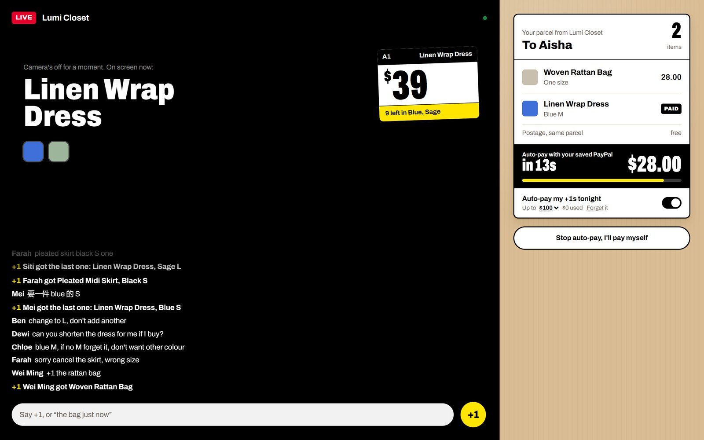
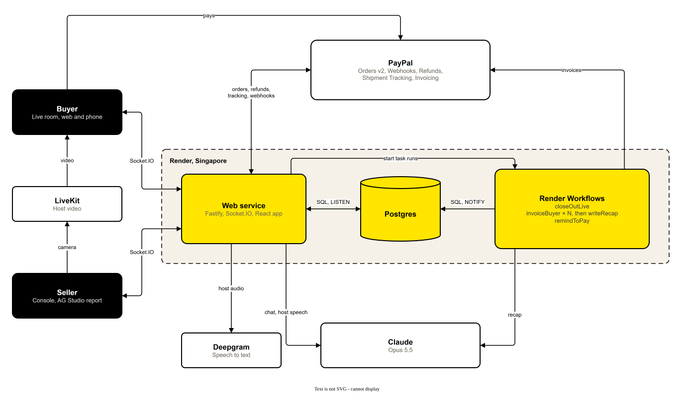
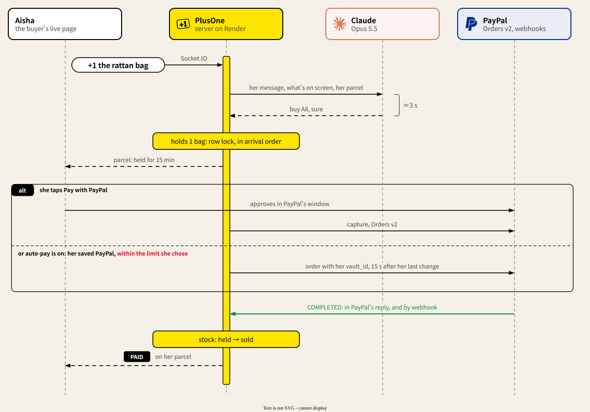
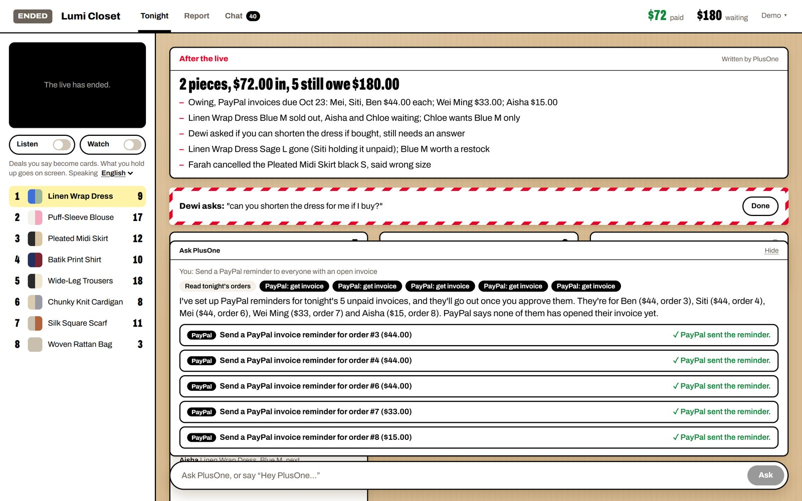
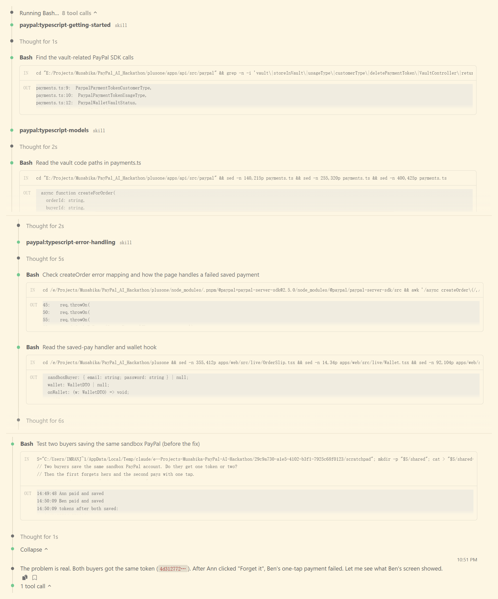

<p>
  <picture>
    <source media="(prefers-color-scheme: dark)" srcset="docs/images/plusone-logo-dark.svg">
    
  </picture>
</p>

**Live-stream selling where buyers talk like people, and every order still comes out right and paid with PayPal.**

**[Watch the video (2:52)](https://youtu.be/uMYv5OYjl1Y)** · **[Live demo](https://plusone-sjgp.onrender.com/live/lumicloset)** · [Try it in a minute](#try-it-in-a-minute) · [How it works](#how-it-works) · Built for the PayPal AI Hackathon


Small sellers sell clothes, snacks and handmade things on live video. Their buyers don't fill in order forms. They type "+1", "the blue one from before, M", "change that to L, don't add another", "if no M forget it", in English, Malay, Chinese or Thai, all at once. Today the seller scrolls back through the chat after the live and rebuilds the orders by hand, and the buyers who said +1 and never paid keep items off sale.

PlusOne sits in the seller's own live page. It follows what is on screen and what each buyer said before, keeps one correct parcel per buyer, asks only when it really can't tell, and collects with PayPal. The host just sells.

## Try it in a minute

1. Open the **[live page](https://plusone-sjgp.onrender.com/live/lumicloset)**. With nobody hosting, a recorded host shows the linen wrap dress, then the rattan bag, and the price label follows what she holds up. (The recording is AI-generated; ordering and paying are live.)
2. Type a name, then **"+1"** while the bag is on screen, or **"the dress just now, blue M"**, then **"change to L, don't add another"**.
3. Pay from your parcel with the PayPal sandbox buyer **`sb-nhtoi53459560@personal.example.com`** / **`YQuz/kn5`** (also shown under the button). Tick "Save my PayPal" and the next order is one tap; turn on auto-pay and just say "+1".
4. Open the **[seller console](https://plusone-sjgp.onrender.com/seller)** (password **`plusonelah`**, shown on the login page). **Demo → Play a busy minute** sends ten buyers through the same chat pipeline; **End live** sends PayPal invoices and writes the night's recap; **Ask PlusOne** "who still owes?".

No real money moves (PayPal Sandbox). The shop resets itself after half an hour of quiet.

## How it's different

Comment-selling tools are common: CommentSold and SoldLive in the US, SHOPLINE in Hong Kong and Taiwan, EasyStore and BigSeller in Southeast Asia. They turn comments into orders, hold carts, run waitlists and send invoices, and they work from a fixed format: a code such as `A1+1`, `CF A01` or `sold 12`, or at the simplest a bare "+1" for the one item in a flash sale (EasyStore). CommentSold can even buy a waitlisted item automatically once the buyer has pre-authorised it. The nearest anyone comes to reading free text is SHOPLINE labelling comments as purchase, question, positive or negative (it doesn't create orders) and SoldLive confirming the variant by text message after the comment.

**Others need buyers to follow a format. PlusOne follows the conversation the way a person does, while the live is happening:**

- "the blue one from before, M" is matched to the product the host showed earlier;
- "change to L, don't add another" edits the order in place;
- "if no M forget it" becomes a conditional order that never takes a different colour;
- "still got pink S?" gets an answer without taking stock;
- English, Malay, Chinese, Thai and Indonesian, mixed in one sentence, answered in the buyer's own language;
- and it asks one short question only when it really can't tell.

Holds, waitlists, per-person limits, reminders and invoices work the way sellers already expect; PlusOne runs them through PayPal.

## A messy chat, end to end

[`scripts/messy-chat.json`](scripts/messy-chat.json) is a made-up live sale written the way buyers type: ten buyers, 22 messages in English, Malay, Chinese and Thai, over four products, with pointing back, changes of mind, a cancellation, a condition, one order split over two messages, questions and chat. Next to it is what a careful seller would write down for each buyer. [`scripts/messy-chat.mjs`](scripts/messy-chat.mjs) plays it through the real chat pipeline on a fresh shop and compares each buyer's parcel.

| In the test chat | Result |
| --- | --- |
| Messages that place, change or cancel an order | 16 of 22 |
| ...written as a product code with a quantity (`A1+1`), or a bare "+1" for a one-option item | 1 |
| Parcels right at the end, three runs in a row | 10 of 10 each time |
| Questions PlusOne asked | 1 ("+1" with the blouse on screen and no colour or size yet) |
| Passed to the seller | 1 ("is the dress see-through?", which the shop's policies don't cover) |
| Average time to PlusOne's reply | about 3 seconds |

This is our own test chat, not data from real sellers: it shows the kind of chat PlusOne is built for, not how often real buyers write this way.

## What you see

**Buyers** see the live video with the chat over it and the price on a shelf label. A name is all it takes to join; PayPal brings the email and address at checkout. Everything they order in one live goes in **one parcel**, drawn as the shipping label it will become: paid items marked PAID, what's still held adding up at the bottom with the time left and one button to pay. PlusOne replies privately, in their language.

**Saved PayPal and auto-pay.** At the first checkout a buyer can save their PayPal with the shop; the next order is one tap, with no PayPal window. Or they turn on auto-pay for this live, up to $50, $100 or $200: "+1 the rattan bag" is then paid within that limit, 15 seconds after the order last changed, so "and the scarf too" joins the same payment. While PlusOne is asking them something, auto-pay waits for the answer.



**The seller** sees tonight's orders as three manifests on a packing table: waiting to pay, paid and ready to pack, sent. The few things only a person can decide sit on red packing tape across the top (a question the shop's policies don't answer, a refund request), with Reply right there. The host can just talk: "dress and blouse together, five dollars off" becomes a card to apply. With **Let PlusOne watch** on, whatever the host holds up to the camera goes on screen for buyers. **Ask PlusOne** sits at the bottom of the table.


## How it works



PlusOne's own code is in yellow. Claude decides what a buyer meant; code decides price, stock and holds; an item is only sold when PayPal says the payment is COMPLETED.



Sources: [`docs/architecture.drawio`](docs/architecture.drawio), [`docs/sequence.drawio`](docs/sequence.drawio).

```text
apps/api        Fastify + Socket.IO server: chat understanding, orders and stock, PayPal, background tasks
apps/web        React live page for buyers (/live/:handle) and the seller console (/seller)
packages/shared Types shared by both
scripts         Dev tunnel, end-to-end PayPal run, demo crowds, the messy-chat test, video shots
```

## PayPal

| What happens | PayPal API |
| --- | --- |
| Buyer pays from their parcel | Orders v2 (`intent=CAPTURE`) through the JS SDK v6 button; the server creates and captures with the [PayPal Server SDK](https://github.com/paypal/PayPal-TypeScript-Server-SDK) |
| Stock is only sold when the money is in | The capture reply, and Webhooks (`PAYMENT.CAPTURE.COMPLETED` and related events), signature-verified; the webhook is created and kept pointed at the server automatically |
| Buyer cancels a paid item | Refunds (partial: one line of a combined order, its share of what was paid) |
| Seller ships | Shipment Tracking on the capture, buyer notified by PayPal |
| Live ends with unpaid holds | Invoicing v2: an invoice per buyer (emailed, or a link on their parcel), items held until it's due, cancelled if it runs out |
| Bundle deals, combined postage | Discount and shipping in the order breakdown |
| Buyer saves PayPal at checkout | Orders v2 with `payment_source.paypal.attributes.vault` (`store_in_vault: ON_SUCCESS`, merchant usage, one token per buyer); the vault id comes back on capture |
| One-tap pay, auto-pay | Orders v2 with `payment_source.paypal.vault_id`, completed in one call, shipped to the address from the saving checkout |
| Buyer forgets their saved PayPal | Payment Method Tokens `DELETE /v3/vault/payment-tokens/{id}` |
| Ask PlusOne | [PayPal Agent Toolkit](https://github.com/paypal/agent-toolkit): orders, invoices (list, search, get, QR code, send reminder, cancel), refunds, shipment tracking, disputes |

Every call that moves money carries a `PayPal-Request-Id`, and a saved-PayPal charge is written down before it is sent, so a retry doesn't charge twice. A PayPal window opened before the buyer changed their order doesn't capture.

## Agents that spend, with limits

Two agents in PlusOne move money, and each one has a limit someone chose.

- **The buyer's**: auto-pay. The buyer saves their PayPal and picks a limit for one live; from then on what they order in chat is paid within it. Every change restarts a short countdown; an open question from PlusOne, or a message still being read, holds it; the limit is checked again at the moment of payment; a declined payment turns auto-pay off instead of retrying. Nothing from the waitlist and no "if no M, forget it" is ever bought on their behalf.
- **The seller's**: Ask PlusOne. It reads freely: tonight's orders, stock, waitlists, and the shop's PayPal invoices, refunds, tracking and disputes through PayPal's Agent Toolkit. It sends nothing by itself: reminders, invoice reminders, cancellations, refunds and shipping come back as cards the seller approves, one by one or all at once.



## AI

Claude (Opus 5.5) does the understanding; code does the money.

- **Chat**: each message is read with what's on screen, what was shown before, the buyer's parcel, waitlists, deals, the shop's policies and what the host said in the last minute. The result is a structured action (buy, change, cancel, question, waitlist...) that the server applies in the order messages arrived.
- **Host camera**: every two seconds the console sends a small frame; Claude names the catalog product being shown, or none. It goes on screen only when two frames in a row agree. Frames aren't stored.
- **Host speech**: the host's voice (Deepgram, streamed through the server) becomes cards for new products, prices, bundles and limits. Nothing changes until the host taps Apply.
- **After the live**: Claude reads the night's orders, stock and chat and leaves the seller a short to-do list.
- **Ask PlusOne**: Claude with tools over tonight's orders and the PayPal Agent Toolkit; the host can also ask out loud ("Hey PlusOne, ...") while selling.
- **Report assistant**: AG Studio's agents run on Claude through the server, with one extra tool that sends payment reminders.
- Evals in `apps/api/src/ai/*.eval.ts` (25 chat cases, 8 host-speech cases) cover what the demo and judges will try, including Malay, Chinese, Thai, Indonesian and Singlish.


## Render Workflows

Work that happens around a live, not in the middle of it, runs as Render Workflows tasks (`apps/api/src/jobs/tasks.ts`):

- `closeOutLive`: when the host ends the live, one `invoiceBuyer` run per buyer who still owes, in parallel, each retrying on its own; then `writeRecap`.
- `remindToPay`: a few minutes before a hold runs out, nudges the buyer in their language, unless they paid or the hold changed.

Tasks only touch Postgres and PayPal; their live updates reach browsers through a Postgres `NOTIFY` channel the web service listens on. Without `RENDER_API_KEY` (local dev) the same functions run inside the API process.

## AG Studio

The Report tab is an AG Studio 3 page on the same kraft table: takings, money still held, units by product, stock with held and waiting counts, and every order line with custom cells (held in yellow, PAID in black, struck-through cancellations, clickable PayPal capture ids). It updates live. Its AI assistant runs AG Studio's built-in agents on Claude plus a `send_payment_reminder` tool. AG Studio is a commercial component, used here under its trial license.


## APIMatic

The PayPal code was written with the APIMatic Context Plugin for Claude Code (PayPal Server SDK skills). Where it changed the code:

- `apps/api/src/paypal/client.ts`: the SDK has no timeout and no retries by default; the client sets both, and POSTs retry only when they carry a request id.
- `describePayPalError` in the same file: reads the typed `result` versus the raw `body` the way the SDK reports them, keeping PayPal's own field names (`debug_id`), and parses the body when only the raw one arrives.
- `apps/api/src/paypal/payments.ts`: create, capture, get and refund follow the SDK's calling conventions (one named-parameter object, SDK enums), each with a request id.
- Saving PayPal: reading the SDK's vault model showed `permitMultiplePaymentTokens`, meant for customers who don't log in to the merchant. PlusOne's buyers never do, and on the demo every judge uses the same sandbox PayPal account, so without it they all shared one token and one buyer's "Forget it" broke everyone else's one-tap. Each buyer now gets their own token, and the vault `description` tells the buyer on PayPal's page which shop they're saving for.

<details>
<summary>The plugin at work in Claude Code (screenshot)</summary>



</details>

## Run locally

Needs Node 22+, pnpm 9, Docker.

```bash
pnpm install
cp .env.example .env     # fill in keys
pnpm db:up               # Postgres in Docker
pnpm --filter @plusone/api db:seed   # demo seller, 8 products, one live session
pnpm dev                 # api on :3000, web on :5174
```

Open <http://localhost:5174> for the live page and <http://localhost:5174/seller> for the console (password is `SELLER_PASSWORD`).

PayPal only delivers webhooks over public HTTPS. With [cloudflared](https://developers.cloudflare.com/cloudflare-one/connections/connect-networks/downloads/) installed, `pnpm dev:public` runs the API behind a quick tunnel and points the PayPal webhook at it; run `pnpm dev:web` alongside.

- `node --env-file=.env scripts/demo-crowd.mjs <scene>` plays a few buyers chatting (`switch`, `last-one`, `deal`, `languages`, `close-out`; add `--reset` for a fresh shop).
- `node --env-file=.env scripts/messy-chat.mjs` runs the messy-chat test against a running API (it resets the shop and makes about 25 Claude calls).
- `node --env-file=.env scripts/video/shot.mjs <shot>` plays one shot of the demo video in a real browser (`crowd`, `host-and-aisha`, `pay-and-save`, `autopay`, `seller`, `try`); with `--record <dir>` it records the shot itself, headless, a track per page plus the marks the edit cuts on.
- `pnpm e2e:pay` clicks through a real sandbox payment and refund.

Tests: `pnpm test` (needs a `plusone_test` database: `docker exec plusone-db psql -U plusone -c "CREATE DATABASE plusone_test"`). AI evals: `pnpm --filter @plusone/api eval`.

## Deploy

`render.yaml` is a Render Blueprint: the web service (API, Socket.IO and the built web app), the workflow service and Postgres, all in Singapore. Secrets are entered in the Render dashboard when the Blueprint is created.

## Limits

- One demo seller and one live at a time; the live page is the seller's own, not TikTok or Facebook.
- PayPal sandbox only, in USD.
- The host in the hosted demo's replay is AI-generated video (made with Seedance 2.5), and the buyers in "Play a busy minute" are simulated. The demo video's narration is a synthetic voice. Every order, payment, refund and invoice is a real PayPal Sandbox call.
- The AI asks when it can't tell, but it can still misread; every change it makes shows up on the seller's manifests and the buyer's own parcel, and buyers can correct it in chat.

## License

MIT. Third-party components keep their own licenses.
